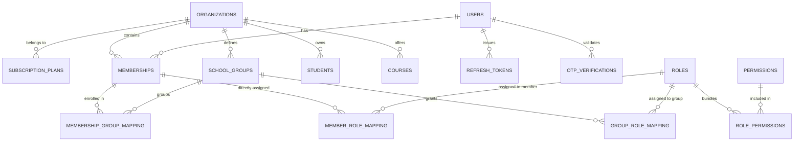
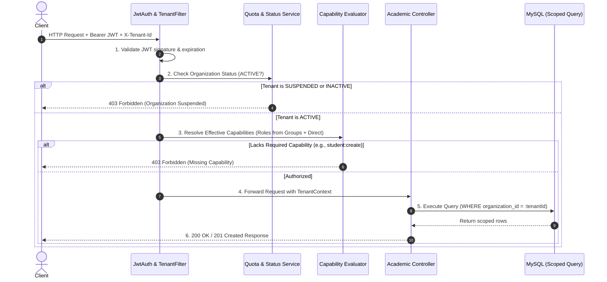

# Component Design & UI/UX Architecture Document

## 1. Design Philosophy
The user interface is designed to be **clean, distraction-free, professional, and accessible**. It employs a minimalist **White, Black, and Blue** design language:
- **No unnecessary technical badges** (such as database logos or framework titles).
- **No complex icons or gamer-style glowing gradients**.
- **Clear visual hierarchy** with distinct contrast for text, actionable buttons, and form controls.

---

## 2. Design System Tokens (`index.css`)

### 2.1 Color Palette
| Token Variable | Hex / Value | Semantic Role |
| :--- | :--- | :--- |
| `--bg-page` | `#f8fafc` | Page body background (soft off-white) |
| `--bg-card` | `#ffffff` | Card, container, and modal backgrounds |
| `--border-color` | `#e2e8f0` | Dividers, table borders, and container outlines |
| `--text-dark` | `#0f172a` | Primary headings, table text, form labels |
| `--text-medium` | `#334155` | Secondary text, user details |
| `--text-muted` | `#64748b` | Placeholders, card labels, metadata |
| `--blue-primary` | `#2563eb` | Primary actions (`Save`, `+ Add Student`, `Sign In`) |
| `--blue-hover` | `#1d4ed8` | Primary button hover state |
| `--blue-light` | `#eff6ff` | Active card fill, informational alert background |
| `--danger-red` | `#dc2626` | Destructive actions (`Delete`, error alerts) |
| `--danger-light` | `#fef2f2` | Danger button hover and error card fill |
| `--success-green`| `#16a34a` | Success toast and notification border |

### 2.2 Typography
- **Font Stack:** `-apple-system, BlinkMacSystemFont, 'Segoe UI', Roboto, Helvetica, Arial, sans-serif`
- **Headings (`h1`–`h3`):** Weight 700, deep navy `#1e3a8a` or dark slate `#0f172a`.
- **Body Text:** Weight 400/500, font size `0.9rem` to `0.95rem`, line height `1.5`.

---

## 3. UI Layout Wireframes

### 3.1 Unauthenticated State (`AuthPage`)
```
┌──────────────────────────────────────────────────┐
│                                                  │
│          ┌────────────────────────────┐          │
│          │  Student Management System │          │
│          │  Management Member Login   │          │
│          ├─────────────┬──────────────┤          │
│          │  [Login]    │  [Register]  │          │
│          ├─────────────┴──────────────┤          │
│          │ Username                   │          │
│          │ [________________________] │          │
│          │ Password                   │          │
│          │ [************************] │          │
│          │                            │          │
│          │ [       Sign In          ] │          │
│          └────────────────────────────┘          │
│                                                  │
└──────────────────────────────────────────────────┘
```

### 3.2 Authenticated Dashboard (`App` + `Navbar` + `CourseCards` + `StudentList`)
```
┌────────────────────────────────────────────────────────────────────────┐
│ Student Management System                   Member: Tanisha [ Logout ] │
├────────────────────────────────────────────────────────────────────────┤
│                                                                        │
│  ┌──────────────┐ ┌──────────────┐ ┌──────────────┐ ┌──────────────┐   │
│  │ All Students │ │ Computer Sc. │ │ Info Tech    │ │ Data Science │   │
│  │      7       │ │      3       │ │      2       │ │      1       │   │
│  │ Total        │ │ 3 Students   │ │ 2 Students   │ │ 1 Student    │   │
│  └──────────────┘ └──────────────┘ └──────────────┘ └──────────────┘   │
│                                                                        │
│  ┌──────────────────────────────────────────────────────────────────┐  │
│  │ [ Search by ID, Name, Course... ] [ Refresh ]    [ + Add Student]│  │
│  ├──────────────────────────────────────────────────────────────────┤  │
│  │ Student ID │ Full Name    │ Email         │ Course │ Sem │Actions│  │
│  ├────────────┼──────────────┼───────────────┼────────┼─────┼───────┤  │
│  │ #101       │ Aarav Sharma │ aarav@ex.com  │ CSE    │  3  │[E] [D]│  │
│  │ #102       │ Priya Patel  │ priya@ex.com  │ IT     │  4  │[E] [D]│  │
│  │ #103       │ Rohan Verma  │ rohan@ex.com  │ CSE    │  3  │[E] [D]│  │
│  └──────────────────────────────────────────────────────────────────┘  │
│                                                                        │
└────────────────────────────────────────────────────────────────────────┘
```

---

## 4. Interaction & Feedback Design

### 4.1 Course Filtering Interaction
- **Default State:** The *"All Students"* card is rendered with `.active` (blue border and soft blue background).
- **Selection State:** Clicking *"Computer Science"* transfers the `.active` style to that card and updates the table to show only CSE students.
- **Filter Indicator:** A blue pill is displayed above the table: *"Filtered by course: Computer Science"* with a *"Show All Courses"* button.

### 4.2 Modal Dialogs (`StudentFormModal` and `DeleteConfirmModal`)
- **Backdrop:** Semi-transparent dark overlay (`rgba(15, 23, 42, 0.45)`) that blocks interaction with underlying controls.
- **Escape / Outside Click:** Clicking the backdrop or cancel button closes the dialog without side-effects.
- **Form Validation:** Real-time red error labels appear under any invalid input field upon submission.

### 4.3 Action Buttons
- **Primary Buttons:** Solid royal blue (`#2563eb`), white text.
- **Outline Buttons:** Clean white background with slate border (`#cbd5e1`), subtle hover shading.
- **Danger Buttons:** White background with red border (`#fca5a5`) and red text (`#dc2626`), darkening on hover.

---

## 5. Modular Monolith Bounded Contexts & Package Architecture

To ensure strict compliance with **SOLID principles**, loose coupling, and maintainability, the backend codebase is partitioned into three distinct Bounded Contexts:

```
com.student.management/
├── platform/               # Context 1: Platform & Tenant Management Context
│   ├── controller/         # PlatformAdminController, SubscriptionPlanController
│   ├── dto/                # OnboardTenantRequest, UpdateTenantStatusRequest, PlanDTO
│   ├── entity/             # Organization, SubscriptionPlan
│   ├── repository/         # OrganizationRepository, SubscriptionPlanRepository
│   └── service/            # TenantProvisioningService, QuotaEnforcementService
│
├── iam/                    # Context 2: Identity & Access Management Context (RBAC & Auth)
│   ├── controller/         # AuthController, MemberManagementController, RbacController
│   ├── dto/                # JwtAuthResponse, RefreshTokenRequest, OtpVerifyRequest, AssignRoleRequest
│   ├── entity/             # User, RefreshToken, OtpVerification, Membership,
│   │                       # SchoolGroup, Role, Permission
│   ├── repository/         # UserRepository, MembershipRepository, RoleRepository, etc.
│   ├── security/           # JwtTokenProvider, JwtAuthFilter, TenantSecurityContext, OtpService
│   └── service/            # AuthService, MemberService, RbacService
│
├── academic/               # Context 3: Academic Core Context (Student & Course Management)
│   ├── controller/         # StudentController, CourseController
│   ├── dto/                # StudentDTO, CourseDTO, CourseCountDTO
│   ├── entity/             # Student, Course (both with mandatory organization_id)
│   ├── repository/         # StudentRepository, CourseRepository (scoped by organization_id)
│   └── service/            # StudentService, CourseService
│
└── shared/                 # Shared Kernel / Cross-Cutting Concerns
    ├── exception/          # ResourceNotFoundException, TenantSuspendedException, UnauthorizedAccessException
    └── util/               # TenantContextHolder, PasswordUtil
```

### 5.1 Inter-Context Communication Rules
- Contexts must **never directly query another context's internal JPA repositories**.
- Contexts communicate strictly via **public Service interfaces** or **DTO contracts**.
- `academic` checks organization status and student quotas by calling `QuotaEnforcementService.validateStudentCapacity(orgId)`.

---

## 6. Relational Database Schema Design (Multi-Tenant & Group RBAC)



### 6.1 Database Table Definitions

```sql
-- Platform Context
CREATE TABLE subscription_plans (
    id BIGINT AUTO_INCREMENT PRIMARY KEY,
    name VARCHAR(50) NOT NULL UNIQUE,          -- 'FREE', 'STANDARD', 'ENTERPRISE'
    max_students INT NOT NULL DEFAULT 100,
    max_staff INT NOT NULL DEFAULT 10,
    price_cents INT NOT NULL DEFAULT 0,
    features_json TEXT,                         -- JSON array of enabled feature keys
    created_at TIMESTAMP DEFAULT CURRENT_TIMESTAMP
);

CREATE TABLE organizations (
    id BIGINT AUTO_INCREMENT PRIMARY KEY,
    name VARCHAR(150) NOT NULL,
    slug VARCHAR(100) NOT NULL UNIQUE,          -- Subdomain/identifier (e.g., 'stanford-high')
    plan_id BIGINT NOT NULL,
    status VARCHAR(30) NOT NULL DEFAULT 'ACTIVE', -- 'ACTIVE', 'SUSPENDED', 'INACTIVE'
    contact_email VARCHAR(150) NOT NULL,
    created_at TIMESTAMP DEFAULT CURRENT_TIMESTAMP,
    CONSTRAINT fk_org_plan FOREIGN KEY (plan_id) REFERENCES subscription_plans(id)
);

-- IAM Context
CREATE TABLE users (
    id BIGINT AUTO_INCREMENT PRIMARY KEY,
    username VARCHAR(100) NOT NULL UNIQUE,
    email VARCHAR(150) NOT NULL UNIQUE,
    password_hash VARCHAR(255) NOT NULL,
    full_name VARCHAR(150) NOT NULL,
    is_super_admin BOOLEAN NOT NULL DEFAULT FALSE,
    created_at TIMESTAMP DEFAULT CURRENT_TIMESTAMP
);

CREATE TABLE refresh_tokens (
    id BIGINT AUTO_INCREMENT PRIMARY KEY,
    user_id BIGINT NOT NULL,
    token_hash VARCHAR(255) NOT NULL UNIQUE,
    expires_at TIMESTAMP NOT NULL,              -- Strict 1-day (24 hr) duration
    created_at TIMESTAMP DEFAULT CURRENT_TIMESTAMP,
    CONSTRAINT fk_refresh_user FOREIGN KEY (user_id) REFERENCES users(id) ON DELETE CASCADE
);

CREATE TABLE otp_verifications (
    id BIGINT AUTO_INCREMENT PRIMARY KEY,
    email VARCHAR(150) NOT NULL,
    otp_code VARCHAR(10) NOT NULL,
    purpose VARCHAR(50) NOT NULL,               -- 'SUPER_ADMIN_LOGIN', 'CLIENT_ONBOARDING'
    expires_at TIMESTAMP NOT NULL,              -- 5-minute validity
    attempt_count INT DEFAULT 0,
    is_verified BOOLEAN DEFAULT FALSE,
    created_at TIMESTAMP DEFAULT CURRENT_TIMESTAMP
);

CREATE TABLE memberships (
    id BIGINT AUTO_INCREMENT PRIMARY KEY,
    user_id BIGINT NOT NULL,
    organization_id BIGINT NOT NULL,
    status VARCHAR(30) NOT NULL DEFAULT 'PENDING_APPROVAL', -- 'PENDING_APPROVAL', 'ACTIVE', 'SUSPENDED'
    approved_by BIGINT NULL,
    approved_at TIMESTAMP NULL,
    created_at TIMESTAMP DEFAULT CURRENT_TIMESTAMP,
    UNIQUE KEY uk_user_org (user_id, organization_id),
    CONSTRAINT fk_member_user FOREIGN KEY (user_id) REFERENCES users(id) ON DELETE CASCADE,
    CONSTRAINT fk_member_org FOREIGN KEY (organization_id) REFERENCES organizations(id) ON DELETE CASCADE
);

CREATE TABLE school_groups (
    id BIGINT AUTO_INCREMENT PRIMARY KEY,
    organization_id BIGINT NOT NULL,
    name VARCHAR(100) NOT NULL,                 -- 'Science Department', 'Admin Staff'
    description TEXT,
    created_at TIMESTAMP DEFAULT CURRENT_TIMESTAMP,
    UNIQUE KEY uk_org_group_name (organization_id, name),
    CONSTRAINT fk_group_org FOREIGN KEY (organization_id) REFERENCES organizations(id) ON DELETE CASCADE
);

CREATE TABLE membership_group_mapping (
    membership_id BIGINT NOT NULL,
    group_id BIGINT NOT NULL,
    PRIMARY KEY (membership_id, group_id),
    CONSTRAINT fk_mgm_member FOREIGN KEY (membership_id) REFERENCES memberships(id) ON DELETE CASCADE,
    CONSTRAINT fk_mgm_group FOREIGN KEY (group_id) REFERENCES school_groups(id) ON DELETE CASCADE
);

CREATE TABLE roles (
    id BIGINT AUTO_INCREMENT PRIMARY KEY,
    organization_id BIGINT NULL,                -- NULL for System Roles; populated for Tenant Custom Roles
    name VARCHAR(100) NOT NULL,                 -- 'SCHOOL_ADMIN', 'TEACHER', 'REGISTRAR'
    description TEXT,
    CONSTRAINT fk_role_org FOREIGN KEY (organization_id) REFERENCES organizations(id) ON DELETE CASCADE
);

CREATE TABLE permissions (
    id BIGINT AUTO_INCREMENT PRIMARY KEY,
    code VARCHAR(100) NOT NULL UNIQUE,          -- 'student:create', 'student:read', 'rbac:manage'
    description VARCHAR(255) NOT NULL
);

CREATE TABLE role_permissions (
    role_id BIGINT NOT NULL,
    permission_id BIGINT NOT NULL,
    PRIMARY KEY (role_id, permission_id),
    CONSTRAINT fk_rp_role FOREIGN KEY (role_id) REFERENCES roles(id) ON DELETE CASCADE,
    CONSTRAINT fk_rp_permission FOREIGN KEY (permission_id) REFERENCES permissions(id) ON DELETE CASCADE
);

CREATE TABLE group_role_mapping (
    group_id BIGINT NOT NULL,
    role_id BIGINT NOT NULL,
    PRIMARY KEY (group_id, role_id),
    CONSTRAINT fk_grm_group FOREIGN KEY (group_id) REFERENCES school_groups(id) ON DELETE CASCADE,
    CONSTRAINT fk_grm_role FOREIGN KEY (role_id) REFERENCES roles(id) ON DELETE CASCADE
);

CREATE TABLE member_role_mapping (
    membership_id BIGINT NOT NULL,
    role_id BIGINT NOT NULL,
    PRIMARY KEY (membership_id, role_id),
    CONSTRAINT fk_mrm_member FOREIGN KEY (membership_id) REFERENCES memberships(id) ON DELETE CASCADE,
    CONSTRAINT fk_mrm_role FOREIGN KEY (role_id) REFERENCES roles(id) ON DELETE CASCADE
);

-- Academic Context (Data Scoped with Discriminator Column)
ALTER TABLE students ADD COLUMN organization_id BIGINT NOT NULL AFTER id;
CREATE INDEX idx_student_org ON students(organization_id);

ALTER TABLE courses ADD COLUMN organization_id BIGINT NOT NULL AFTER id;
CREATE INDEX idx_course_org ON courses(organization_id);
```

---

## 7. UI Layout Wireframes: Platform Control Panel & School RBAC

### 7.1 Platform Control Panel (`/admin/control-panel`)
```
┌──────────────────────────────────────────────────────────────────────────────────┐
│  PLATFORM CONTROL PANEL (Super Admin Only)               SuperAdmin (Ayush) [ ⚙ ]│
├──────────────────────────────────────────────────────────────────────────────────┤
│                                                                                  │
│  [ + Onboard New School ]    [ System Health: Optimal ]    [ Active Tenants: 14 ]│
│                                                                                  │
│  ┌────────────────────────────────────────────────────────────────────────────┐  │
│  │ Search Schools...                                           [ Filter Status]│  │
│  ├────────────────────────────────────────────────────────────────────────────┤  │
│  │ School Name      │ Slug         │ Plan       │ Students │ Status   │ Action│  │
│  ├──────────────────┼──────────────┼────────────┼──────────┼──────────┼───────┤  │
│  │ Delhi Public Sc. │ dps-main     │ ENTERPRISE │ 840 / ∞  │ [ACTIVE] │[Manage│  │
│  │ Modern Academy   │ modern-acad  │ STANDARD   │ 412/1000 │ [ACTIVE] │[Manage│  │
│  │ City High School │ city-high    │ FREE       │ 99 / 100 │ [SUSPEND]│[Manage│  │
│  └────────────────────────────────────────────────────────────────────────────┘  │
│                                                                                  │
│  [Onboard Modal]: Org Name, Admin Email, Plan Selection -> Sends Gmail OTP       │
└──────────────────────────────────────────────────────────────────────────────────┘
```

### 7.2 School RBAC & Group Management View (`/app/settings/rbac`)
```
┌──────────────────────────────────────────────────────────────────────────────────┐
│  Delhi Public School - Staff & Access Control                Admin: Rahul [Logout│
├──────────────────────────────────────────────────────────────────────────────────┤
│  [ Members (24) ]    [ Groups & Departments (5) ]    [ Roles & Permissions ]     │
│                                                                                  │
│  Pending Approvals (2):                                                          │
│  • Ananya Sen (Pending)  -> [ Assign Group: Science Dept ] [ Approve ] [ Reject ]│
│  • Vikram Roy (Pending)  -> [ Assign Group: Admin Staff  ] [ Approve ] [ Reject ]│
│                                                                                  │
│  Active Groups:                                                                  │
│  ┌──────────────────────┬────────────────────────┬────────────────────────────┐  │
│  │ Group Name           │ Assigned Roles         │ Members Count              │  │
│  ├──────────────────────┼────────────────────────┼────────────────────────────┤  │
│  │ Science Department   │ TEACHER                │ 12 Teachers                │  │
│  │ Academic Office      │ REGISTRAR, DATA_VIEWER │ 4 Staff Members            │  │
│  │ School Admin Group   │ SCHOOL_ADMIN           │ 2 Administrators           │  │
│  └──────────────────────┴────────────────────────┴────────────────────────────┘  │
└──────────────────────────────────────────────────────────────────────────────────┘
```

---

## 8. Request Authorization & Decision Pipeline



