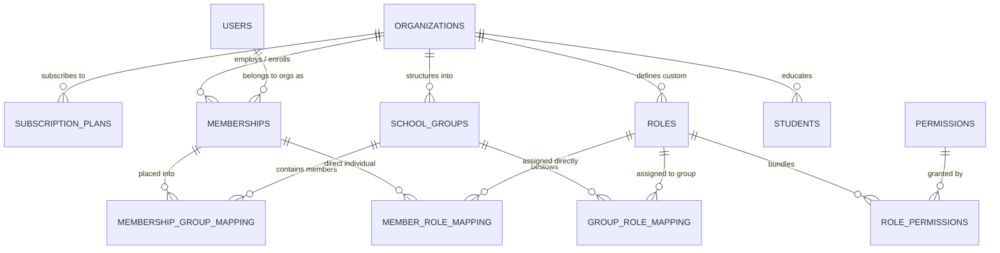
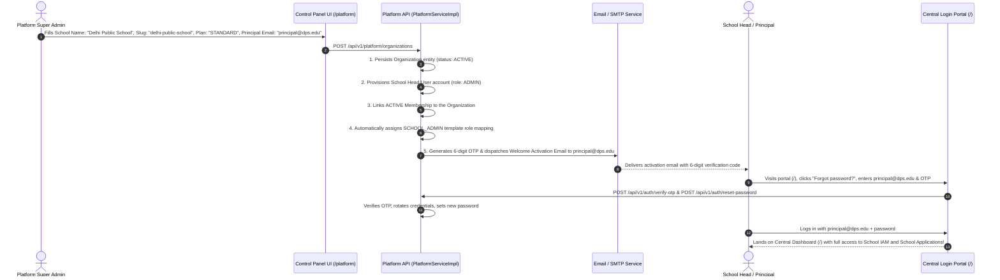
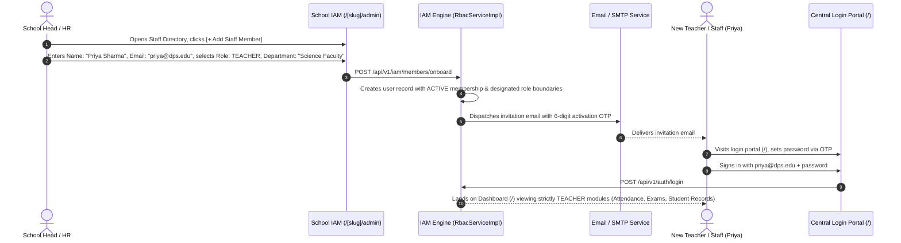
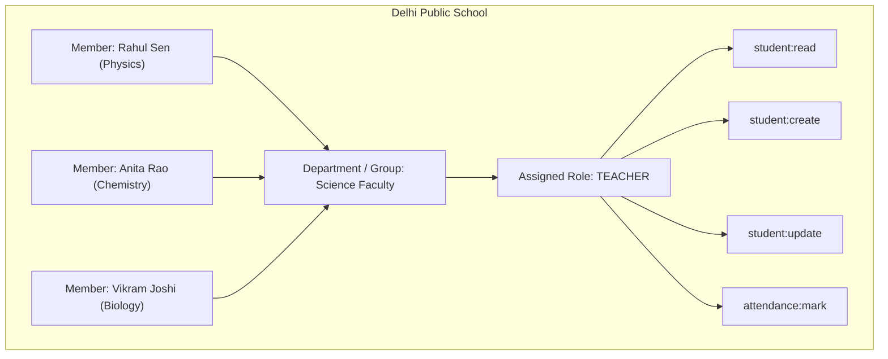
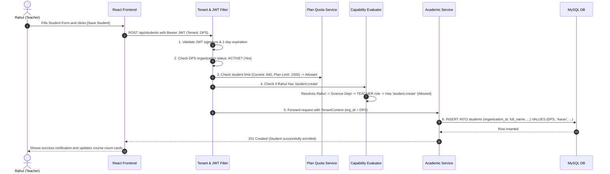

# Real-Life Staff Workflow, Entity Relationships & RBAC Guide

## 1. Executive Summary & Foundational Question Answered

### Question: Does the system pre-define permissions, or can staff create their own?

```
┌────────────────────────────────────────────────────────────────────────────────────────┐
│                              THE GOLDEN RULE OF RBAC                                   │
│  1. PERMISSIONS ARE SYSTEM-DEFINED (CAPABILITIES BACKED BY CODE).                      │
│  2. ROLES ARE USER/STAFF-DEFINED (CUSTOM BUNDLES OF SYSTEM PERMISSIONS).               │
│  3. GROUPS ARE ORGANIZATIONAL DEPARTMENTS (SETS OF SCHOOL MEMBERS).                    │
└────────────────────────────────────────────────────────────────────────────────────────┘
```

#### Why are Permissions System-Defined?
A permission represents a concrete capability that backend software actually knows how to execute and protect. 
For example:
- `student:create` executes the `POST /api/students` endpoint and validates student uniqueness.
- `student:delete` triggers `DELETE /api/students/{id}` and verifies enrollment records.
- `attendance:mark` updates the attendance ledger.

If a staff member could invent an arbitrary permission code (e.g., `fly:airplane` or `exam:approve`), the backend would have **no controller, logic, or database query** to enforce it. Therefore:
* The **System provides a rich, granular Permission Catalog** covering all school resources and actions.
* The **School Staff creates custom Roles** by bundling any combination of these system permissions together.
* For maximum convenience, the system ships with **Pre-seeded Role Templates** (`SCHOOL_ADMIN`, `TEACHER`, `REGISTRAR`, `STUDENT`) so schools can start instantly without building roles from scratch.

---

## 2. Real-Life Entities & Real-World School Analogy

To make the architecture intuitive, here is how each database entity maps to real-world school operations:

| Database Entity | Real-World Equivalent | Real-Life Concrete Example |
| :--- | :--- | :--- |
| `organizations` | The School or Institution | *"Delhi Public School, R.K. Puram"* |
| `subscription_plans` | School's Commercial Tier | *"Standard Plan: Up to 1,000 Students & 50 Staff"* |
| `users` | A Human Being with an Identity | *"Priya Sharma (priya@dps.edu, verified by Gmail OTP)"* |
| `memberships` | Employment or Enrollment Status | *"Priya Sharma is an ACTIVE staff member at DPS"* |
| `school_groups` | Departments or Operational Teams | *"Science Department"*, *"Class 10 Faculty"*, *"Exam Board"* |
| `roles` | Job Titles / Duty Responsibilities | *"Department Head"*, *"Class Teacher"*, *"Lab Incharge"* |
| `permissions` | Specific Authorized Actions | `student:read`, `student:write`, `attendance:mark` |
| `students` | The Enrolled Student Body | *"Aarav Patel, Roll #101, Grade 10, Computer Science"* |

---

## 3. Entity Relationship Architecture



---

## 4. Step-by-Step Real-Life Operational Flows

### Flow 1: Platform Super Admin Onboards a New School & Principal (Implemented)

This flow executes when the **Platform Super Admin** onboards a school via the **Platform Control Panel** (`/platform`):



---

### Flow 2: School Staff Onboarding (Zero Public Registration Policy)

To eliminate spam and unauthorized access, **public self-registration is strictly disallowed**. All personnel must be onboarded directly by the **School Head or School HR** from **School IAM**:



---

### Flow 3: How School Staff Sets Up Groups & Assigns Roles

Staff does not need to configure permissions for 100 teachers one by one. They assign roles to **Groups**:



* **Outcome:** When a new teacher is added to the "Science Faculty" group, they **automatically inherit** `student:read`, `student:create`, `student:update`, and `attendance:mark` without manual role assignment.

---

### Flow 4: Creating a Custom Role for a Special Purpose

Suppose the school has an **"Exam Incharge"** who should enter student marks and view records, but **must NEVER delete students or change school settings**.

1. **Staff opens:** `Settings > Roles & Permissions > [+ Create New Role]`.
2. **Staff enters:** Role Name = `"Exam Incharge"`, Description = *"Can view students and submit term exam marks"*.
3. **Staff picks from System Permission Catalog:**
   - [x] `student:read`
   - [x] `grade:enter`
   - [x] `grade:export`
   - [ ] `student:delete` *(Disabled)*
   - [ ] `rbac:manage` *(Disabled)*
4. **Staff assigns Role:** Assigns `"Exam Incharge"` to Teacher *Anita Rao* or to the *"Examination Committee"* group.
5. **Backend saves:**
   - Inserts row into `roles` with `organization_id = :dpsId`.
   - Inserts rows into `role_permissions` mapping `role_id` to `permission_id`.

---

### Flow 5: Everyday Operation (Executing an Action with Security Verification)

When Teacher *Rahul* clicks *"Add Student"* on the dashboard:



---

## 5. Built-in Standard Permission Catalog (System-Defined)

The system ships with the following standard capabilities that staff can assign to roles:

| Domain Resource | Permission Code | Description | Default Pre-Seeded In |
| :--- | :--- | :--- | :--- |
| **Students** | `student:read` | View student rosters and individual profiles | `SCHOOL_ADMIN`, `TEACHER`, `REGISTRAR` |
| **Students** | `student:create` | Add new student records | `SCHOOL_ADMIN`, `REGISTRAR` |
| **Students** | `student:update` | Modify existing student details | `SCHOOL_ADMIN`, `REGISTRAR` |
| **Students** | `student:delete` | Remove student records from system | `SCHOOL_ADMIN` only |
| **Courses** | `course:read` | View department course listings | All Roles |
| **Courses** | `course:manage` | Add, update, or decommission courses | `SCHOOL_ADMIN` |
| **Access Control** | `rbac:manage` | Create roles, groups, and approve members | `SCHOOL_ADMIN` only |
| **Staff & Groups** | `staff:assign_group`| Move members between departments/groups | `SCHOOL_ADMIN`, `HOD` |
| **Reports** | `report:export` | Download rosters and metric summaries | `SCHOOL_ADMIN`, `REGISTRAR` |
| **Attendance** | `attendance:mark` | Record daily student attendance | `SCHOOL_ADMIN`, `TEACHER` |

---

## 6. Summary: Why This Gives Clients Total Autonomy

1. **No Code Changes for New Job Titles:** If a school creates a new position (e.g. *"Sports Coordinator"* or *"Library Assistant"*), staff creates the role and checks the required permissions right from the UI.
2. **Zero Admin Bottlenecks:** Group-based mapping means adding 50 teachers to the "Science Faculty" group instantly assigns all of them the correct access.
3. **Ironclad Multi-Tenant Isolation:** Everything is strictly bound to `organization_id`, ensuring no school can ever view or mutate another school's data.
4. **Platform Control Panel Stays in Our Hands:** We manage tenant licenses, suspension, quotas, and onboarding from our private control panel without interfering in the school's daily internal operations.
