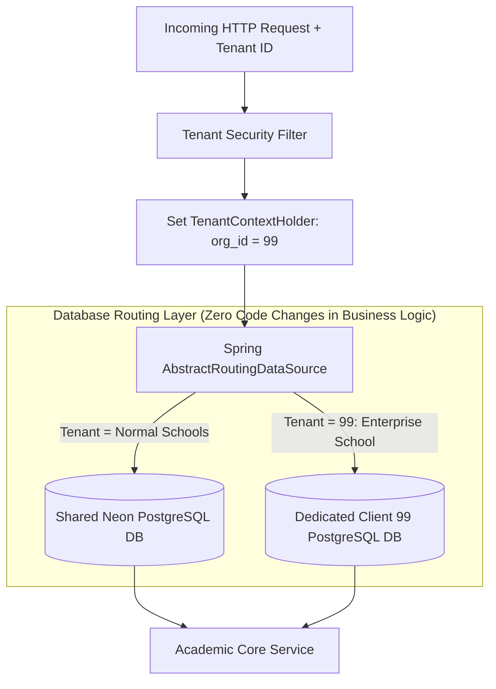

# Engineering Learnings, Production Decoupling & Future DB Separation Guide

## 1. Executive Purpose & Educational Goal

This document serves as our **living engineering logbook**. It explains:
1. How our **Modular Monolith** is engineered today on a shared database while remaining **100% loosely coupled** so that separating databases in production in the future requires zero architectural refactoring.
2. The core design principles that prevent database coupling traps.
3. A systematic record of technical issues faced, tradeoffs evaluated, and lessons learned.

---

## 2. The Architectural Strategy: Loose Coupling for Future Database Separation

### 2.1 The Common Database Coupling Trap
In many multi-tenant projects, separating a client into their own dedicated database later is almost impossible because developers write **cross-boundary SQL joins**:

```sql
-- ❌ DANGEROUS COUPLING (Breaks if tables move to different databases):
SELECT s.full_name, u.email, sp.name AS plan_name
FROM students s
JOIN users u ON s.created_by = u.id
JOIN organizations o ON s.organization_id = o.id
JOIN subscription_plans sp ON o.plan_id = sp.id;
```

If a large school requests their own physical database for compliance, this query crashes because `users` and `subscription_plans` live on a different database server than `students`!

---

### 2.2 The 4 Decoupling Rules Enforced in Our Codebase

```
┌────────────────────────────────────────────────────────────────────────────────────────┐
│                               FOUR DECOUPLING RULES                                    │
├────────────────────────────────────────────────────────────────────────────────────────┤
│ 1. Zero Cross-Context Foreign Keys or SQL JOINs                                        │
│    • Academic tables store 'organization_id' and 'user_id' as plain BIGINT scalar      │
│      identifiers. They do NOT declare cross-module database foreign keys.              │
│    • Resolving user or school names is done via Java Service interfaces, never JOINs. │
├────────────────────────────────────────────────────────────────────────────────────────┤
│ 2. Context-Isolated Repositories                                                       │
│    • 'StudentService' never injects 'UserRepository' or 'SubscriptionPlanRepository'.  │
│    • It communicates exclusively via public DTOs and Service interfaces.               │
├────────────────────────────────────────────────────────────────────────────────────────┤
│ 3. Spring AbstractRoutingDataSource Pattern                                            │
│    • The application code does not know which physical database it is talking to.      │
│    • Spring dynamically routes connections based on the current 'TenantContextHolder'. │
├────────────────────────────────────────────────────────────────────────────────────────┤
│ 4. Domain Event Publishing                                                             │
│    • Cross-context side-effects (e.g. school suspension) trigger asynchronous internal │
│      Domain Events rather than direct transactional mutations across tables.          │
└────────────────────────────────────────────────────────────────────────────────────────┘
```

---

## 3. How Decoupling to a Dedicated Client DB Works in the Future

When an enterprise client requires their own dedicated PostgreSQL database:



### The Spring Implementation Pattern:
```java
public class TenantRoutingDataSource extends AbstractRoutingDataSource {
    @Override
    protected Object determineCurrentLookupKey() {
        return TenantContextHolder.getTenantId(); // Returns "default" or "client_99"
    }
}
```
* **Result:** Controllers, Services, and Repositories remain **100% unchanged**. Only the connection lookup map is updated.

---

## 4. Engineering Learnings & Troubleshooting Log

This section records every technical hurdle encountered, the root cause, and the solution applied.

### Learning 1: Fixed Port Strategy to Prevent Environment Collisions
* **Problem:** Default ports like `8080` (Spring Boot) and `3000` (Node/Next.js) frequently collide with developer tools, proxies, or previous zombie processes.
* **Root Cause:** Operating systems and developer machines often have running Docker containers or system daemons bound to `8080` and `3000`.
* **Solution:** Standardized fixed, non-colliding ports:
  * Backend: **`8085`**
  * Frontend: **`4000`**
  * Configured `CorsConfig.java` to explicitly whitelist `http://localhost:4000` and updated `start_backend.bat` and `start_frontend.bat`.

---

### Learning 2: Architecture Evolution from Vite to Next.js App Router
* **Problem:** Vite is lightweight for client-only SPAs, but lacks server-side routing security, built-in reverse proxying for production, and standalone Docker optimization.
* **Root Cause:** Enterprise multi-tenant platforms require protected routes (`/admin/control-panel` vs `/settings/rbac`), server-side cookie guards, and clean edge deployments.
* **Solution:** Migrated to Next.js 15 (React 19) App Router:
  * Kept 100% of our custom White/Black/Blue CSS design system tokens in `src/index.css`.
  * Configured `next.config.mjs` API proxy rewrites to forward `/api/*` to `http://localhost:8085`.
  * Added SSR-safe `typeof window !== 'undefined'` guards to `studentService.js` to eliminate hydration warnings.

---

### Learning 3: Cloud PostgreSQL Migration with SSL & Connection Pooling
* **Problem:** Moving from local MySQL to Neon Serverless PostgreSQL required dialect and SSL changes.
* **Root Cause:** Serverless cloud PostgreSQL (Neon, Supabase) enforces TLS/SSL connections and uses pooled endpoints (`-pooler`) for serverless connection scaling.
* **Solution:**
  1. Replaced `mysql-connector-j` with official `org.postgresql:postgresql` in `pom.xml`.
  2. Set `spring.jpa.properties.hibernate.dialect=org.hibernate.dialect.PostgreSQLDialect`.
  3. Added `sslmode=require` to the JDBC connection string.
  4. Verified live startup: Hibernate connected over SSL, validated schemas, and seeded initial records.

---

### Learning 4: Object Storage Strategy for Multi-Tenant Files
* **Problem:** Deciding how many S3 buckets to provision for client files (photos, report cards, ID documents).
* **Root Cause:** Cloud providers impose account-level bucket limits (often 100 max). Provisioning a bucket per school creates management bottlenecks and slow onboarding.
* **Solution:** Adopted the **1-Bucket Tenant-Prefix Model**:
  * Single bucket: `school-management-storage`.
  * Files organized cleanly by organization folder: `org_{id}/students/avatars/` and `org_{id}/documents/`.
  * Complete isolation enforced via backend pre-signed URL generation.

---

### Learning 5: Multi-Tenant Data Isolation, Quotas, and Hierarchical Group RBAC
* **Problem:** Ensuring that client schools cannot see each other's student records, platform admins have aggregated quota visibility without breaching privacy, and staff members receive accurate capability permissions through departmental group hierarchies.
* **Root Cause & Technical Insights:**
  1. *Scalar ID Coupling:* Physical foreign keys across bounded contexts (e.g. `students` -> `organizations`) create tight database locking and prevent physical database separation later. Using scalar `BIGINT` foreign keys allows modular monolith partitioning and future `AbstractRoutingDataSource` sharding with zero code refactoring.
  2. *Tenant Context Interception:* `TenantContextFilter` extracts the tenant identifier from HTTP headers (`X-Tenant-ID`), validates against `OrganizationRepository`, instantly rejects requests from `SUSPENDED` schools with `403 Forbidden`, and injects the tenant ID into `TenantContextHolder` (ThreadLocal).
  3. *Student Capacity Quota Enforcement:* `StudentService` collaborates with `PlatformService.validateStudentCapacity(orgId)` before persisting any student, ensuring schools cannot exceed their subscription plan limits (`FREE`: 100, `STANDARD`: 1,000, `ENTERPRISE`: 100,000).
  4. *Hierarchical Group RBAC Computation:* Staff members receive capability permissions via two concurrent paths: Direct Role assignments and Departmental Group inheritance. The `RbacService.getMemberPermissionSummary` calculates the union of permissions from both paths without duplicating permissions.

---

### Learning 6: Production Engineering Standard — Interface/Impl, MapStruct, Lombok, and DTO Encapsulation
* **Problem:** Ensuring code conforms to production architecture standards without entity leakage, boilerplate overhead, manual mapping errors, or premature scope creep on unrelated domain models.
* **Root Cause & Technical Insights:**
  1. *Interface & Impl Separation:* Services must expose a contract interface in `service/` and conceal the implementation under `service/impl/`. Controllers and other modules inject the interface, enabling loose coupling, mocking, and future alternative implementations.
  2. *DTO Encapsulation:* Database `@Entity` classes must never be returned from or accepted into REST endpoints. Every payload must be an explicit Request or Response DTO.
  3. *MapStruct Compile-Time Mapping:* Replaces manual, reflection-heavy mapping with zero-overhead compile-time generated mappers configured via `@Mapper(componentModel = "spring")`.
  4. *Lombok Integration:* Eliminates hundreds of lines of boilerplate getters, setters, and constructors while preserving immutable builder patterns.
  5. *Zero Emojis & SLF4J:* Absolute ban on emojis and `System.out.println`. All logging flows through `@Slf4j` with structured context.
  6. *Scope Discipline:* Preserved `User` and `Student` untouched so that foundational platform and IAM capabilities are cleanly established before modifying academic and authentication domains.

---

## 5. Maintenance Checklist for New Features

Whenever implementing a new feature, verify against this learning checklist:
- [ ] Does this query avoid cross-context SQL joins?
- [ ] Is `organization_id` included in every query filter?
- [ ] Is the service method adhering to Single Responsibility?
- [ ] Are all variables and files following the documented naming conventions?
- [ ] Is the code completely free of dead imports and unnecessary lines?
