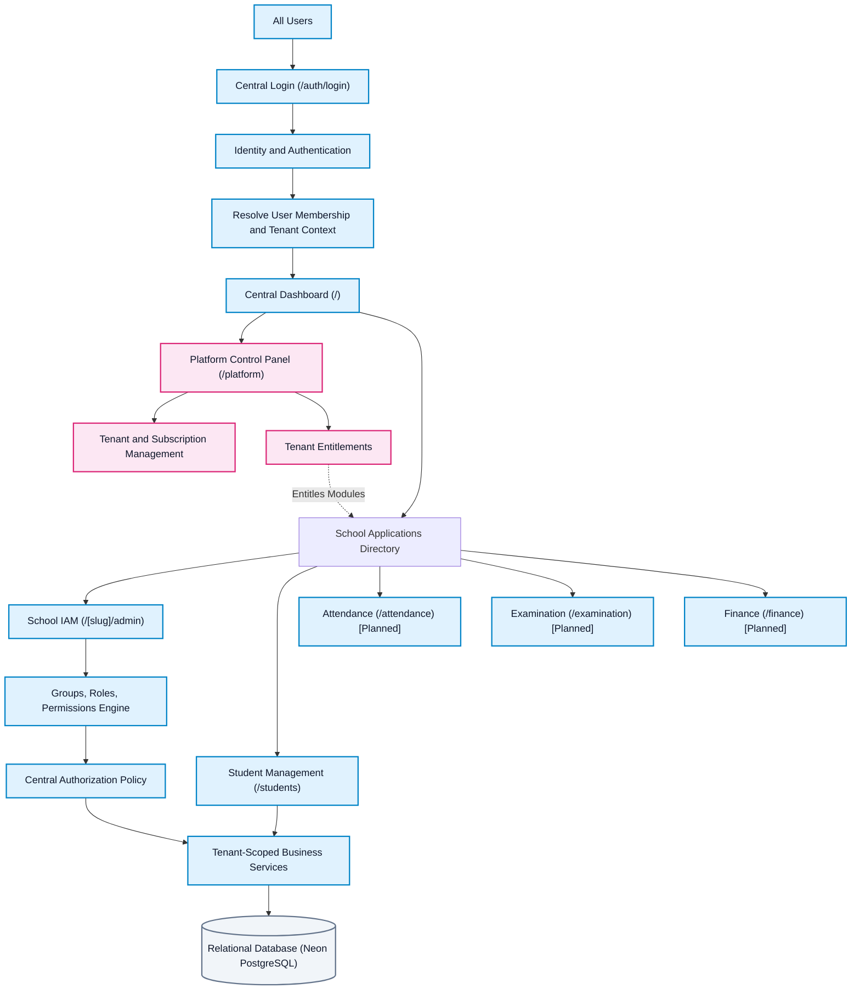

# Modular Monolith Architecture & Dynamic Application Visibility Guide
**Platform:** My School Care  
**Architecture Style:** Modular Monolith (Domain-Driven, Multi-Tenant, Zero-Leakage Isolation)  
**Reference Diagram:** `docs/architecture/system_architecture.png`

---

## 1. System Architecture Overview

My School Care is built as a **Modular Monolith** where independent functional domains are packaged into strictly separated modules sharing a single runtime and database while maintaining clear domain boundaries.



---

## 2. Target Package Hierarchy (Modular Monolith)

Following domain-driven design, the application is organized into 6 core domains:

```
my-school-care/
├── platform/                      # Global SaaS Control Plane (Super Admin Only)
│   ├── tenant/                    # Institutional School Tenant Provisioning & Lifecycle
│   ├── subscription/              # Plans, Student/Staff Quotas, Billing Tiers (FREE, STANDARD, ENTERPRISE)
│   └── platform-admin/            # Platform Operator Controls & Cross-Tenant Analytics
│
├── identity/                      # Authentication & Identity Provider (IdP)
│   ├── authentication/            # Login, JWT Access/Refresh Token Rotation, OTP Verification
│   ├── user/                      # Central User Accounts, Credentials, Password Hashes
│   └── membership/                # Organization Memberships (User <-> Tenant Mapping & Status)
│
├── iam/                           # Identity & Access Management (Tenant Governance)
│   ├── role/                      # Custom & Template Roles (Principal, Registrar, Accountant, Teacher)
│   ├── permission/                # Fine-Grained Permission Registry (Read/Write/Delete/Approve)
│   ├── group/                     # Departmental & Organizational Groups (Science Dept, Accounts)
│   └── authorization/             # Effective Permission Resolution Engine & RBAC Evaluator
│
├── tenancy/                       # Multi-Tenancy Boundary Isolation Engine
│   ├── TenantContext              # ThreadLocal Tenant State Holder (TenantId, TenantSlug)
│   ├── TenantContextFilter        # Request Interceptor extracting X-Tenant-ID / Slug
│   └── TenantAccessValidator      # Cross-Tenant Boundary Enforcement & Security Guards
│
├── applications/                  # Application Directory & Dynamic Visibility Engine
│   ├── registry/                  # Master Catalog of Platform Modules (Code, Title, Route, Required Permissions)
│   └── entitlement/               # Dynamic Resolver mapping User Roles -> Visible Dashboard Cards
│
└── school/                        # School Academic & Operational Business Modules
    ├── student/                   # Student Enrollment, Courses, Semesters, Academic Profiles
    ├── attendance/                # Daily Student & Staff Attendance Tracking
    ├── examination/               # Exam Schedules, Grading Systems, Marks, Circulars
    └── finance/                   # Fee Schedules, Invoices, Payment Collections, Ledgers
```

---

## 3. Dynamic Application Visibility Dataflow

### How Role-Based Application Visibility Works:
1. **Central Login**:
   - Every user logs in via `POST /api/v1/auth/login`.
   - The backend validates password and issues a cryptographic JWT + rotated Refresh Token.
2. **Context Resolution**:
   - If `is_super_admin = true`:
     - Scope: `GLOBAL_PLATFORM`
     - Visible Applications: `[Platform Control Panel]`
     - Quick Action: `Onboard School`
   - If School Staff / Head:
     - Scope: `TENANT_SPECIFIC` (e.g. `Delhi Public School`)
     - Backend queries active `OrganizationMembership` $\rightarrow$ resolved roles $\rightarrow$ effective permissions.
     - `applications/entitlement` service matches user's permissions against the `applications/registry`.
3. **Application Directory Response (`authorizedApplications`)**:
   - The API returns the exact array of operable application cards that the user is entitled to see.
4. **School Head IAM Customization**:
   - Inside School IAM (`/[slug]/admin`), the School Head can create custom roles (e.g., `Registrar`, `Accountant`, `Teacher`, `Exam Counselor`).
   - The School Head selects checkboxes for module permissions:
     - **Registrar Staff**: `STUDENT_REGISTRY:READ`, `STUDENT_REGISTRY:WRITE` $\rightarrow$ Sees **Staff & Student Records**.
     - **Accountant**: `FINANCE:READ`, `FINANCE:WRITE` $\rightarrow$ Sees **Fee & Finance Management**.
     - **Exam Counselor**: `EXAM:READ`, `EXAM:WRITE` $\rightarrow$ Sees **Exams & Report Cards**.
     - **Teacher**: `ATTENDANCE:READ`, `ATTENDANCE:WRITE` $\rightarrow$ Sees **Attendance Management**.
   - The central dashboard at `/` automatically renders **only** the allowed cards dynamically!

---

## 4. Multi-Tenant Security & Zero-Leakage Guarantees

1. **Defense in Depth**:
   - UI hiding is strictly for user experience.
   - Every backend API request passes through `TenantContextFilter` and Spring Security filters.
2. **Tenant Scoping**:
   - All school business entities extend `BaseTenantEntity` with an indexed `organization_id`.
   - JPA queries automatically scope to `WHERE organization_id = TenantContext.getTenantId()`.
3. **Cross-Tenant Prevention**:
   - Any attempt to access an unauthorized tenant's data or endpoints returns HTTP `403 Forbidden` / `404 Not Found`.

---

## 5. Automated School Onboarding & Password Setup Workflow

### Implementation Contract:
When a **Platform Super Admin** onboards a school via `POST /api/v1/platform/organizations`:
1. **Organization Creation**: Saves school record (Name, Slug, Subscription Plan).
2. **Head User Provisioning**: Provisions the School Head user account (`role = "ADMIN"`) with initial locked password.
3. **Membership & Role Assignment**: Creates `ACTIVE` membership and attaches the `SCHOOL_ADMIN` template role.
4. **Email OTP Dispatch**: Automatically triggers `OtpService.generateAndSendOtp(headEmail, "ONBOARDING_SETUP")` sending the 6-digit activation code to the Principal's email.
5. **Principal Password Setup**:
   - The Principal goes to the login page (`/`).
   - Clicks *"Forgot password?"*, submits their email and the 6-digit OTP received in their inbox.
   - Sets their permanent password.
6. **Isolated Access Verification**:
   - The Principal signs in.
   - **Super Admin** sees ONLY `Platform Control Panel`.
   - **School Head** sees ONLY their own school's modules (`IAM`, `Student Records`, `Attendance`, `Exams`, `Finance`) and data. Zero platform control panel access is permitted.

