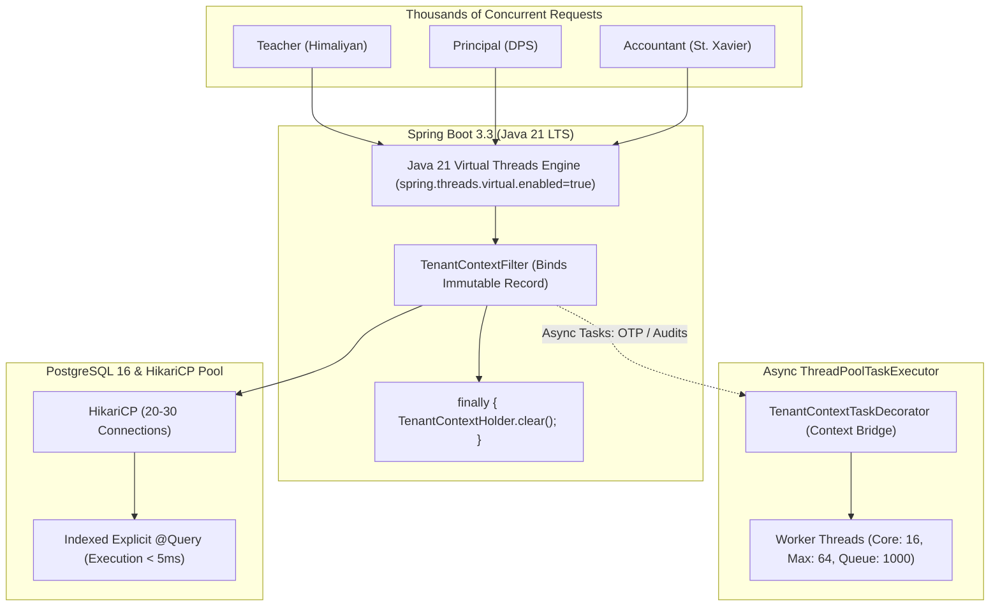

# IAM Module Architecture & Multi-Tenant Data Isolation Specification
## High-Throughput Concurrency, Thread Safety & Zero-Trust Tenant Boundary Blueprint

**Target Platform:** My School Care Educational SaaS Platform  
**Architecture Classification:** Keycloak 26-Style Multi-Tenant IAM with High-Throughput Concurrency  
**Technology Stack:** Java 21 LTS (Virtual Threads), Spring Boot 3.3.x, Spring Security 6.3.x, Spring Data JPA / Hibernate 6.6.x, PostgreSQL 16 LTS, HikariCP, JJWT 0.12.x, Next.js 15  
**Document Status:** Approved Engineering Implementation Standard  

---

## 1. Executive Summary & Problem Analysis

In our educational multi-tenant SaaS platform, every school institution (e.g. *Delhi Public School*, *Himaliyan Public School*, *St. Xavier High School*) operates as an independent, autonomous organization.

### 1.1 The Prototype Root Causes (Why Leaks & Re-logins Occurred)
1. **Unscoped Fallback Bug**: Frontend previously defaulted missing tenant state to `active_tenant_id = 1` (Delhi Public School) and controllers accepted optional `@RequestParam Long orgId`.
2. **Missing Token Claims**: Early JWT tokens only encoded global user credentials, passing empty extra claims without signing `org_id` or `membership_id`.
3. **Thundering Herd Re-login Loop**: When access tokens expired during active usage, multiple parallel dashboard calls simultaneously requested token refreshes. The first request rotated the token, causing remaining calls to fail with `400 Bad Request`, destroying browser local storage and forcing repeated logouts.
4. **Thread Starvation & Context Leakage**: Relying on unmanaged Tomcat OS threads under high concurrency risked thread exhaustion and cross-tenant pollution on thread reuse.
5. **JPA Query Blindness**: Relying purely on auto-generated JPA query naming created single-point-of-failure vulnerabilities if a developer wrote an unscoped `findById(id)`.

---

## 2. The 5-Layer Multi-Tenant Data Isolation Strategy

Every request must pass through **five strict isolation verification gates**:

```
[Incoming Request]
       │
       ▼
┌────────────────────────────────────────────────────────────────────────┐
│ Gate 1: URL & Subdomain Routing (/[slug]/admin)                        │  Resolves Tenant Slug Hint
└────────────────────────────────────────────────────────────────────────┘
       │
       ▼
┌────────────────────────────────────────────────────────────────────────┐
│ Gate 2: Client Single-Flight Refresh Queue (apiClient.ts)              │  Prevents 401 Re-login Loops
└────────────────────────────────────────────────────────────────────────┘
       │
       ▼
┌────────────────────────────────────────────────────────────────────────┐
│ Gate 3: Cryptographic JWT Claims & Active Membership Verification     │  Validates org_id & ACTIVE status
└────────────────────────────────────────────────────────────────────────┘
       │
       ▼
┌────────────────────────────────────────────────────────────────────────┐
│ Gate 4: Thread-Bound Immutable TenantContext & TaskDecorator           │  ThreadLocal with guaranteed cleanup
└────────────────────────────────────────────────────────────────────────┘
       │
       ▼
┌────────────────────────────────────────────────────────────────────────┐
│ Gate 5: Database Repository Explicit @Query Scoping                    │  WHERE organization_id = :orgId
└────────────────────────────────────────────────────────────────────────┘
```

### Gate 1: URL & Institutional Routing
* School administrative workspaces operate on explicit institutional URLs: `http://localhost:4000/[slug]/admin`.
* Client route guards prevent cross-tenant UI rendering: if a user authenticated for *Himaliyan Public School* opens `/delhi-public-school/admin`, the UI triggers the **Tenant Boundary Guard** and blocks cross-tenant view.

### Gate 2: Client Single-Flight Refresh Queue
* When access tokens expire, `apiClient.ts` engages an in-memory mutex (`isRefreshing = true`).
* All concurrent dashboard requests (members, roles, groups) pause in an in-memory queue.
* Only **one** refresh request hits `/api/v1/auth/refresh-token`. Once the new access token arrives, all paused requests retry transparently with zero UI stutter.

### Gate 3: Cryptographic Token Claims & Server-Side Membership Check
* The Access Token is signed with HMAC-SHA256 containing:
  `org_id`, `org_slug`, `membership_id`, `userId`, `role`.
* `TenantContextFilter` extracts these claims. For non-superadmin users, client headers are untrusted; the cryptographic token claim is the **authoritative truth**.
* **Active Status Check**: The filter verifies that the user's membership in that organization is currently `ACTIVE`. If the principal suspended the staff member, requests are immediately denied with `403 Forbidden`.

### Gate 4: Thread-Bound Immutable TenantContext
* The verified identity is wrapped in an immutable Java record: `TenantContext`.
* It is bound to the worker thread via `TenantContextHolder` and **guaranteed to be cleared in a `finally` block** before the thread returns to the pool.

### Gate 5: Database Repository Explicit `@Query` Scoping
* All repository lookups eschew blind auto-generated JPA query methods in favor of explicit JPQL `@Query` annotations binding `:orgId`.
* No query can execute across tenant boundaries.

---

## 3. High-Throughput Concurrency & Thread Executor Architecture

Serving thousands of concurrent users across multiple schools requires an architecture that prevents thread starvation and context leaks.



### 3.1 Java 21 Virtual Threads (Zero Thread Starvation)
By enabling Java 21 Virtual Threads in `application.yml`:
```yaml
spring:
  threads:
    virtual:
      enabled: true
```
Tomcat replaces heavy 1MB–2MB platform threads with lightweight virtual threads. A single application instance can process 10,000+ concurrent I/O-bound requests simultaneously without running out of JVM heap memory.

### 3.2 High-Throughput Async Executor with `TaskDecorator`
When background operations run (e.g. audit event logging, sending email invites, batch provisioning), parent thread context is bridged into worker threads using `TaskDecorator`:

```java
@Configuration
@EnableAsync
public class AsyncConcurrencyConfig {

    @Bean(name = "tenantTaskExecutor")
    public Executor tenantTaskExecutor() {
        ThreadPoolTaskExecutor executor = new ThreadPoolTaskExecutor();
        executor.setCorePoolSize(16);
        executor.setMaxPoolSize(64);
        executor.setQueueCapacity(1000);
        executor.setThreadNamePrefix("TenantWorker-");
        executor.setRejectedExecutionHandler(new ThreadPoolExecutor.CallerRunsPolicy());
        executor.setTaskDecorator(new TenantContextTaskDecorator());
        executor.initialize();
        return executor;
    }

    public static class TenantContextTaskDecorator implements TaskDecorator {
        @Override
        public Runnable decorate(Runnable runnable) {
            TenantContext callerContext = TenantContextHolder.getContext();
            return () -> {
                try {
                    if (callerContext != null) {
                        TenantContextHolder.setContext(callerContext);
                    }
                    runnable.run();
                } finally {
                    TenantContextHolder.clear();
                }
            };
        }
    }
}
```

### 3.3 Immutable `TenantContext` Contract
```java
package com.student.management.shared.context;

import java.io.Serializable;

public record TenantContext(
        Long userId,
        Long organizationId,
        Long membershipId,
        String organizationSlug,
        String role,
        boolean isSuperAdmin,
        boolean isSuspended
) implements Serializable {

    public static TenantContext empty() {
        return new TenantContext(null, null, null, null, null, false, false);
    }

    public boolean hasTenant() {
        return organizationId != null && organizationId > 0;
    }
}
```

---

## 4. Token Expiration, Rotation & Sliding Window Lifecycle

### 4.1 Token Specifications
- **Access Token**: Short-lived (15–30 minutes) stateless JWT for fast API authentication.
- **Refresh Token**: Long-lived (7 days) cryptographically random token stored in database table `refresh_tokens`.
- **Sliding Expiration**: As long as staff members remain active on the platform, each token refresh extends session validity by 7 days. Re-login is only required after true 7-day inactivity.

### 4.2 Server-Side Token Rotation Grace Period (30 Seconds)
When a refresh token is rotated:
- Rather than immediately deleting the old token, the backend marks it with a 30-second leeway timestamp.
- If a secondary browser tab submits the old token within 30 seconds due to network latency, the backend returns the already issued new access token instead of killing the session.

---

## 5. Explicit Repository `@Query` Isolation Standard

We strictly eliminate blind JPA method generation. All tenant-scoped operations must use explicit JPQL queries with `:orgId`:

### 5.1 MembershipRepository Standard
```java
public interface MembershipRepository extends JpaRepository<Membership, Long> {

    @Query("SELECT m FROM Membership m WHERE m.id = :id AND m.organizationId = :orgId")
    Optional<Membership> findByIdAndOrganizationId(@Param("id") Long id, @Param("orgId") Long orgId);

    @Query("SELECT m FROM Membership m WHERE m.organizationId = :orgId ORDER BY m.createdAt DESC")
    List<Membership> findAllByOrganizationId(@Param("orgId") Long orgId);

    @Query("SELECT m FROM Membership m WHERE m.organizationId = :orgId AND m.status = :status")
    List<Membership> findAllByOrganizationIdAndStatus(
            @Param("orgId") Long orgId, 
            @Param("status") MembershipStatus status
    );

    @Query("SELECT m FROM Membership m WHERE m.userId = :userId AND m.organizationId = :orgId")
    Optional<Membership> findByUserIdAndOrganizationId(@Param("userId") Long userId, @Param("orgId") Long orgId);

    @Query("SELECT COUNT(m) > 0 FROM Membership m WHERE m.userId = :userId AND m.organizationId = :orgId")
    boolean existsByUserIdAndOrganizationId(@Param("userId") Long userId, @Param("orgId") Long orgId);
}
```

### 5.2 SchoolGroupRepository Standard
```java
public interface SchoolGroupRepository extends JpaRepository<SchoolGroup, Long> {

    @Query("SELECT g FROM SchoolGroup g WHERE g.id = :id AND g.organizationId = :orgId")
    Optional<SchoolGroup> findByIdAndOrganizationId(@Param("id") Long id, @Param("orgId") Long orgId);

    @Query("SELECT g FROM SchoolGroup g WHERE g.organizationId = :orgId ORDER BY g.name ASC")
    List<SchoolGroup> findAllByOrganizationId(@Param("orgId") Long orgId);

    @Query("SELECT COUNT(g) > 0 FROM SchoolGroup g WHERE g.organizationId = :orgId AND LOWER(g.name) = LOWER(:name)")
    boolean existsByOrganizationIdAndNameIgnoreCase(@Param("orgId") Long orgId, @Param("name") String name);
}
```

### 5.3 RoleRepository Standard
```java
public interface RoleRepository extends JpaRepository<Role, Long> {

    @Query("SELECT r FROM Role r WHERE (r.organizationId IS NULL OR r.organizationId = :orgId) ORDER BY r.name ASC")
    List<Role> findAllAvailableRoles(@Param("orgId") Long orgId);

    @Query("SELECT r FROM Role r WHERE r.id = :id AND (r.organizationId IS NULL OR r.organizationId = :orgId)")
    Optional<Role> findRoleByIdAndOrganizationId(@Param("id") Long id, @Param("orgId") Long orgId);
}
```

---

## 6. Core IAM Domain Entities & Partitioning Rules

| Entity | Partitioning Strategy | Description |
| :--- | :--- | :--- |
| `users` | **Global Platform Pool** | Global user identity credentials (`username`, `email`, `password_hash`). |
| `organizations` | **Tenant Anchor Root** | Institutional root entity (`id`, `name`, `slug`, `status`, `plan_id`). |
| `memberships` | **Strictly Scoped (`organization_id`)** | Links global `User` to `Organization`. Stores `status` (`ACTIVE`, `SUSPENDED`). |
| `school_groups` | **Strictly Scoped (`organization_id`)** | Departments/Teams (e.g. Science Faculty, Accounts Dept). |
| `roles` | **Hybrid Scoping (`organization_id` NULLable)** | • `organization_id IS NULL`: Immutable system templates (`SCHOOL_ADMIN`, `TEACHER`).<br/>• `organization_id = :orgId`: Custom roles created by the school. |
| `permissions` | **Global Platform Catalog** | Granular capabilities (`STUDENT_CREATE`, `ATTENDANCE_MARK`, `FEES_COLLECT`). |
| `member_roles` | **Membership Bound** | Maps roles directly to a specific `membership_id`. |
| `group_roles` | **Group Bound** | Roles inherited by all members assigned to a department/group. |
| `membership_groups`| **Membership Bound** | Maps staff members to departments/groups. |

---

## 7. Staff Provisioning Workflows

School Principals manage staff through two distinct modes from `/[slug]/admin`:

### Mode A: Instant Provisioning (Direct Credential Setup)
1. Principal inputs Full Name, Email, Username, and creates a master password.
2. System checks for duplicate email/username.
3. Account is created, `Membership` is marked `ACTIVE`, and selected roles/groups are assigned immediately.
4. Staff member can log in instantly.

### Mode B: Automated Email Invitation Handshake
1. Principal inputs Full Name, Email, Username, and selects "Send Automated Email Invitation".
2. System creates User stub with random password and `Membership` marked `PENDING_APPROVAL` or `ACTIVE`.
3. System dispatches a 6-digit verification code with secure link:
   `http://localhost:4000/setup-password?email=staff@school.edu&slug=st-xavier-high-school`.
4. Staff member verifies OTP, creates their permanent password, and enters their workspace.

---

## 8. Comprehensive REST API Specifications

All endpoints require authentication and are prefixed by `/api/v1/iam`. The tenant context is bound by verified JWT claims.

### 8.1 Staff Members
- `GET /api/v1/iam/members?status=ACTIVE`: List staff members for active tenant.
- `POST /api/v1/iam/members`: Provision new staff member (Mode A or Mode B).
- `PATCH /api/v1/iam/members/{membershipId}/status`: Suspend or activate staff member.
- `GET /api/v1/iam/members/{membershipId}/permissions`: Inspect effective permissions for member.

### 8.2 Roles & Capabilities
- `GET /api/v1/iam/roles`: List all available roles (System Templates + School Custom Roles).
- `POST /api/v1/iam/roles`: Create school-scoped custom role with selected capability permissions.
- `GET /api/v1/iam/permissions`: List all global platform capability permissions.

### 8.3 Departments & Groups
- `GET /api/v1/iam/groups`: List school groups/departments with member counts.
- `POST /api/v1/iam/groups`: Create school department.
- `POST /api/v1/iam/groups/{groupId}/roles`: Assign roles to group (inherited by all members).
- `POST /api/v1/iam/members/{membershipId}/groups`: Assign staff member to department.
- `POST /api/v1/iam/members/{membershipId}/roles`: Assign direct roles to staff member.

---

## 9. Implementation Checklist

1. [x] **JWT Multi-Tenant Claims**: Signed `org_id`, `org_slug`, and `membership_id` in access tokens.
2. [x] **Cross-Tenant Isolation Guard**: Frontend blocks mismatched `organizationSlug` against URL slug.
3. [ ] **Immutable `TenantContext` & Unified Holder**: Refactor `TenantContextHolder` to use `TenantContext` record with strict `finally { clear(); }`.
4. [ ] **Async Concurrency Configuration**: Implement `AsyncConcurrencyConfig` with `TenantContextTaskDecorator`.
5. [ ] **Enable Java 21 Virtual Threads**: Add `spring.threads.virtual.enabled: true` in `application.yml`.
6. [ ] **Explicit `@Query` Repositories**: Bind explicit `:orgId` queries in `MembershipRepository`, `RoleRepository`, and `SchoolGroupRepository`.
7. [ ] **Client-Side Refresh Mutex**: Implement single-flight queue in `apiClient.ts` to eliminate parallel 401 token refresh collisions.
