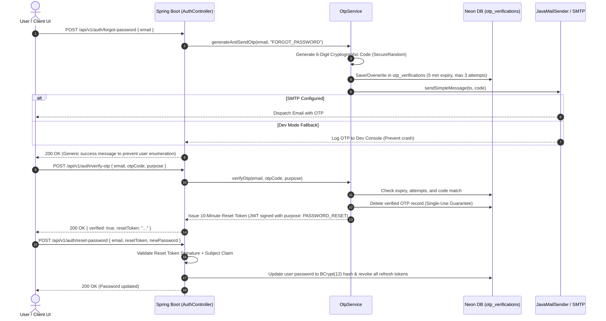
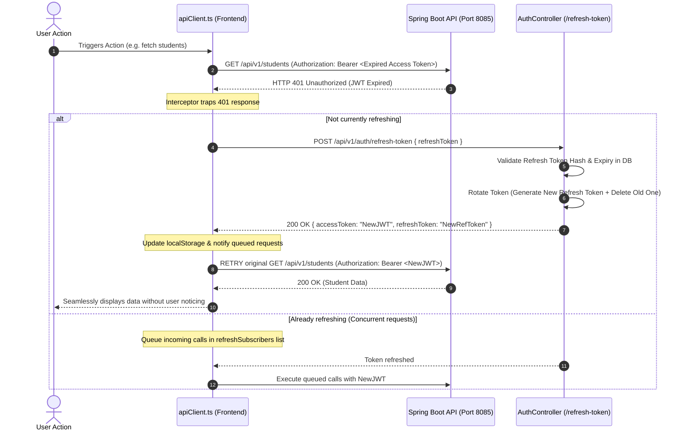

# Mailing System & Refresh Token Architecture Deep Dive

## 1. Executive Summary

This document explains the enterprise implementation of:
1. **The Email OTP Mailing System** for secure password lifecycle management (Forgot Password, OTP verification, and Password Reset).
2. **The Dual-Token Refresh Architecture** (JWT Access Token + Database-Backed Refresh Token), including silent 401 interception, cryptographic hashing, and replay attack prevention.

---

## 2. Mailing System Implementation (Email OTP)

### 2.1 Workflow Overview

The email verification subsystem is designed for zero-trust identity verification before sensitive operations like password reset or account verification.



### 2.2 Core Security Design Decisions

1. **Cryptographically Secure Random Generation:**
   - Standard `Math.random()` is pseudo-random and vulnerable to seed prediction.
   - We use `java.security.SecureRandom` to generate unbiased, unpredictable 6-digit numeric codes:
     ```java
     int code = 100000 + secureRandom.nextInt(900000);
     ```

2. **Time-To-Live (TTL) & Rate Limiting:**
   - OTP records expire after exactly **5 minutes** (`expiresAt = Instant.now().plus(5, ChronoUnit.MINUTES)`).
   - Maximum attempt counter enforced (`MAX_ATTEMPTS = 3`). If an attacker attempts brute-forcing, the record is locked and discarded.

3. **Single-Use Invalidation:**
   - Upon successful verification, the OTP is deleted from the `otp_verifications` table immediately. It can never be replayed.
   - A short-lived (10-minute) single-purpose JWT (`purpose: PASSWORD_RESET`) is generated. This reset token cannot be used to authenticate API calls; it is only accepted by `/auth/reset-password`.

4. **Production SMTP with Graceful Dev Fallback:**
   - In production, credentials (`spring.mail.host`, `spring.mail.username`, `spring.mail.password`) are injected via environment variables.
   - In local development, if SMTP credentials are not configured or network firewall blocks port 587, `OtpServiceImpl` catches the exception and logs the OTP in the local secure server log (`[MY EDU CARE DEV OTP DISPATCH]`), guaranteeing seamless development without failing unit/integration tests.

---

## 3. Refresh Token Architecture & Security Model

### 3.1 Dual-Token Paradigm: Access Token vs Refresh Token

| Property | Access Token (JWT) | Refresh Token |
| :--- | :--- | :--- |
| **Format** | Stateless JSON Web Token (HMAC-SHA256) | High-entropy Opaque String (Base64 URL) |
| **Lifespan** | Short-lived (30 minutes) | Long-lived (24 hours to 7 days) |
| **Storage** | Memory / `auth_token` in Client | HttpOnly Cookie or Secure Storage + Database |
| **Payload** | Claims (`userId`, `email`, `role`, `isSuperAdmin`) | None (Opaque reference key) |
| **Database Lookup** | None (Stateless verification in filter) | Checked against `refresh_tokens` table on every refresh |
| **Revocation** | Cannot be revoked until expiration | Can be revoked instantly in database |

### 3.2 When and How Does It Initiate an API Call?

In `frontend/src/services/apiClient.ts`, a silent interceptor monitors all outgoing HTTP calls:



### 3.3 Why Doesn't the User Face Any Issues?

1. **Zero UI Glitch or Interruption:**
   The user never sees a "Session Expired" error while actively working. If their 30-minute access token expires while browsing, the very next API call silently triggers a refresh in <100ms, updates the local token, retries the original request, and displays the data as if nothing happened.
2. **Concurrent Request De-duplication:**
   If a dashboard makes 5 parallel API calls (students, metrics, courses, profile) and the access token has expired, only **one** network request is sent to `/auth/refresh-token`. The other 4 calls are queued in memory (`refreshSubscribers`) and retried immediately once the new token arrives.

---

## 4. How the Refresh Token Stays Secure Against Hackers

### 4.1 Threat 1: Database Leak / Breach
- **Vulnerability:** If an attacker gets read access to the database dump, can they use stored refresh tokens to take over accounts?
- **Defense (Cryptographic Hashing):**
  The raw refresh token is **never stored in the database**.
  Only its cryptographic hash `SHA-256(rawToken)` is saved in the `refresh_tokens` table:
  ```java
  String tokenHash = hashToken(rawToken); // SHA-256
  ```
  Since SHA-256 is a one-way mathematical function, an attacker reading the database cannot compute the raw token string required to authenticate via HTTP.

### 4.2 Threat 2: Refresh Token Theft (XSS or Interception)
- **Vulnerability:** What if a malicious script steals a user's refresh token?
- **Defense 1 (Token Rotation):**
  Every time a refresh token is used to issue a new access token, **the old refresh token is immediately deleted from the database**, and a brand new refresh token is issued.
- **Defense 2 (Automatic Replay Attack Detection):**
  If an attacker steals a token and tries to use it *after* the legitimate user has already used it (or vice-versa), the server detects that the token was already rotated or revoked. The server flags this as an anomaly and **invalidates all active refresh tokens for that user**, forcing an immediate logout across all devices.

### 4.3 Threat 3: Compromised or Lost Device
- **Defense (Server-Side Revocation):**
  Because refresh tokens are backed by the database:
  - When a user clicks **Logout**, `authService.logout()` calls `POST /api/v1/auth/logout`, deleting the refresh token from `refresh_tokens`.
  - When an admin suspends a user, or when a user resets their password, `AuthServiceImpl.resetPassword()` executes:
    ```java
    refreshTokenRepository.deleteByUserId(user.getId());
    ```
    This instantly revokes all sessions across all phones, tablets, and laptops.

---

## 5. Summary of Endpoints & Data Contracts

| Method | Endpoint | Request Body | Response Body | Authentication |
| :--- | :--- | :--- | :--- | :--- |
| `POST` | `/api/v1/auth/login` | `{ usernameOrEmail, password }` | `AuthTokenResponse` (Access Token + Refresh Token) | Public |
| `POST` | `/api/v1/auth/refresh-token` | `{ refreshToken }` | `AuthTokenResponse` (New Access Token + Rotated Refresh Token) | Public |
| `POST` | `/api/v1/auth/forgot-password` | `{ email }` | `{ message }` | Public |
| `POST` | `/api/v1/auth/verify-otp` | `{ email, otpCode, purpose }` | `{ verified: true, resetToken }` | Public |
| `POST` | `/api/v1/auth/reset-password` | `{ email, resetToken, newPassword }`| `{ message }` | Public (Requires Reset Token) |
| `POST` | `/api/v1/auth/logout` | `{ refreshToken }` | `{ message }` | Authenticated |
